# Chapter 2: Background Study

This chapter reviews the research and existing systems that inform the *AI Legal Advisor and Analyzer*. Section 2.1 surveys legal artificial intelligence, legal document analysis, information retrieval, retrieval-augmented generation (RAG) and AI-based legal advisory systems. Section 2.2 compares the most relevant studies and platforms and identifies the research gap. Section 2.3 states the research objectives that respond to that gap.

## 2.1 Literature Review

### 2.1.1 Legal Artificial Intelligence and Legal NLP

Legal artificial intelligence (Legal AI) applies computational methods to legal tasks such as judgment prediction, similar-case matching, legal question answering and document review. Zhong et al. [1] surveyed the field from both a legal and an NLP perspective. They compared embedding-based methods, which learn representations from data, with symbol-based methods, which encode legal knowledge explicitly. Their experiments on judgment prediction, similar-case matching and legal question answering showed that embedding-based methods predict well. However, these methods often lack interpretability and struggle with rare cases and very long legal documents. Both weaknesses matter for a system that must explain the law to non-experts.

A second line of work adapts pre-trained language models to legal text. Chalkidis et al. [2] introduced LEGAL-BERT and showed that further pre-training BERT on legal corpora, or pre-training it from scratch on them, outperforms an off-the-shelf BERT on domain tasks. Zheng et al. [3] reached a more nuanced conclusion with the CaseHOLD dataset, which contains more than 53,000 multiple-choice questions about case holdings. Domain pre-training helped most when the task was close to the pre-training corpus and difficult enough to need legal knowledge. To support standardised evaluation, Chalkidis et al. [4] released LexGLUE, a benchmark of seven English legal datasets on which legal-oriented models generally outperformed generic ones.

Most of this work concerns European and United States law. The closest large-scale South Asian resource is ILDC [5], a corpus of about 35,000 Indian Supreme Court cases for court judgment prediction with explanation. Its best model reached about 78% accuracy against about 94% for legal experts. The authors also reported clear differences between the reasoning of the model and that of the experts. Two lessons follow for this project: models trained on one jurisdiction do not transfer automatically to another, and outcome prediction without faithful explanation is of limited value to a citizen.

Research on Pakistani law is still small but growing. Maqsood, Ul-Hasan and Shafait [18] proposed a transformer-based architecture that predicts the outcome of Pakistani legal proceedings and extracts the passages that explain each decision. They introduced VerdictVaultPK, a dataset of rental-property case proceedings, which is directly relevant to the property-dispute domain of this project. Faisal and Yousaf [19] released LEGAL-UQA, a parallel English-Urdu question-answering dataset of 619 question-answer pairs built from the Constitution of Pakistan. They used Urdu OCR to digitise the Urdu text. These studies show that Pakistani legal NLP is feasible. They also show that the available datasets focus either on prediction for specialists or on constitutional text, not on guidance for citizens in property and family matters.

### 2.1.2 Large Language Models in Law and the Problem of Hallucination

Large language models (LLMs) have shown strong general legal ability. Katz et al. [7] reported that GPT-4, tested zero-shot on the full Uniform Bar Examination in the United States, scored about 297 points, well above the passing threshold in every jurisdiction that uses the exam. LegalBench [6], a benchmark of 162 tasks designed by legal professionals and covering six types of legal reasoning, was used to evaluate 20 open-source and commercial LLMs. It showed that performance varies considerably across types of reasoning.

General ability does not guarantee reliable answers. Ji et al. [10] describe *hallucination* as the generation of content that is unfaithful to the source or not supported by fact, and they identify it as a central problem for all natural-language generation. In law the consequences are serious. Dahl et al. [8] profiled legal hallucinations in public LLMs, including ChatGPT 4, and found that the models hallucinated at least 58% of the time on verifiable questions about United States federal court cases. They also found that the models often failed to recognise their own errors and accepted users' incorrect legal assumptions. The authors warn against unsupervised use of general-purpose LLMs for legal tasks. These findings directly support the concern raised in Chapter 1 that general chatbots can produce legal statements that cannot be checked.

### 2.1.3 Information Retrieval and Semantic Search for Legal Text

Classical retrieval matches query terms against documents using sparse methods such as TF-IDF and BM25. Ordinary users rarely describe their problems in statutory language. A tenant who writes "my landlord told me to leave in a week" uses none of the words found in the relevant rent law. Dense retrieval addresses this mismatch by encoding queries and passages as vectors and comparing their meaning. Karpukhin et al. [12] showed that a dual-encoder dense passage retriever (DPR) outperformed a strong BM25 baseline by 9 to 19 percentage points in top-20 passage retrieval accuracy on open-domain question answering. Reimers and Gurevych [13] introduced Sentence-BERT, which uses siamese and triplet networks to produce sentence embeddings that can be compared efficiently with cosine similarity. It is the basis of the open-source Sentence Transformers library selected for this project.

Dense retrieval needs an efficient nearest-neighbour index. Johnson, Douze and Jégou [14] presented FAISS, a library for billion-scale similarity search that makes large vector collections practical to search. Dedicated vector databases add storage, payload metadata and filtering on top of such indexes. Qdrant [20], the vector database selected for this project, combines approximate nearest-neighbour search based on HNSW graphs with payload indexes. A search can therefore be restricted by metadata, such as legal area or topic, while still ranking results by semantic similarity.

### 2.1.4 Retrieval-Augmented Generation

Retrieval-augmented generation combines a retriever with a generator. Lewis et al. [11] introduced RAG as a model that pairs a pre-trained sequence-to-sequence generator with a dense vector index queried by a neural retriever. On knowledge-intensive question answering it outperformed models that relied only on knowledge stored in their parameters. Gao et al. [15] surveyed later work and grouped it into Naive, Advanced and Modular RAG. They present RAG as a response to three problems of LLMs: hallucination, outdated knowledge and lack of transparency about where an answer comes from. Because a RAG system can show the passages it retrieved, its answers can be traced to sources. A standalone LLM cannot offer this property, and it is essential in law.

Two legal RAG systems are especially relevant. Louis, van Dijck and Spanakis [16] built a *retrieve-then-read* pipeline for long-form legal question answering, with a lightweight bi-encoder retriever and an instruction-tuned LLM as the reader. They released LLeQA, a dataset of 1,868 expert-annotated French-language legal questions on Belgian law. Automatic metrics were promising, but qualitative analysis showed that answers still needed improvement, which confirms that retrieval alone does not guarantee correct reasoning. Cui et al. [17] developed ChatLaw, a Chinese legal LLM that adds a knowledge-base reference module to reduce hallucination. It also uses a separate model to extract legal key words from user queries before retrieval, a step similar in purpose to the fact-clarification step proposed in this project.

RAG reduces hallucination but does not remove it. Magesh et al. [9] carried out the first pre-registered evaluation of commercial RAG-based legal research tools. They found that Lexis+ AI, Westlaw AI-Assisted Research and Ask Practical Law AI each hallucinated between 17% and 33% of the time, despite vendor claims of being "hallucination-free". The tools performed better than GPT-4 alone, but errors remained substantial. Two design consequences follow, and both are adopted in this project. First, retrieval must be paired with an explicit check that every cited source was actually retrieved and supports the statement. Second, the system must say when it has no verified source instead of producing a confident answer.

### 2.1.5 Legal Document Analysis and OCR

Citizens often hold the evidence that decides their case on paper: rent agreements, notices, nikah nama, receipts and court orders. Extracting text from such documents is the first step towards analysing them. Born-digital PDF files contain a text layer that libraries such as PyMuPDF can read directly. Scanned pages and photographs need optical character recognition (OCR). The LEGAL-UQA study [19] illustrates the practical problem in Pakistan: the official English constitution was available as text, while the Urdu version was available only as images, so the authors had to use an Urdu OCR system. Once text is available, clause-level information such as rent amount, tenancy period or notice terms can be identified and linked to the user's case. Among the systems reviewed in Section 2.2, none of the Pakistani platforms states in its public description that it performs OCR on user evidence or generates a case-specific evidence checklist.

### 2.1.6 AI-Based Legal Advisory and Legal-Technology Systems

Commercial legal AI products mostly serve professionals. Lexis+ AI and Westlaw AI-Assisted Research, both evaluated in [9], are research assistants for lawyers in the United States. In South Asia, the Supreme Court of India launched SUPACE (Supreme Court Portal for Assistance in Court's Efficiency) in April 2021 to help judges gather facts and law. It was explicitly described as a research aid that does not decide cases [27].

In Pakistan, several legal-technology platforms are listed in the Stanford CodeX TechIndex, a directory of legal-technology products. The TechIndex states that its listings are informational, may be out of date and are not endorsed by Stanford. MyCounsel combines a lawyer marketplace with AI legal-research tools [21]. QanoonAI offers a database of Pakistani judgments with tools for case briefs, petition drafting, citation verification, court-fee calculation and Urdu-language guidance [22]. PakLegalAI is described as combining an AI chatbot, case-law research, legal drafting and a directory of bar-council-verified lawyers [23]. Pakistan LawBot offers AI legal question answering, statute and case-law search and lawyer discovery [24]. These platforms show both commercial interest and user demand. Their public descriptions, however, centre on research, drafting or lawyer discovery. None of them describes a workflow that clarifies a citizen's facts, grounds every answer in cited and checked law, reads the citizen's evidence and follows the case through to resolution.

The need is considerable. The World Justice Project ranked Pakistan 130th of 143 countries in its 2025 Rule of Law Index [25]. Reporting on the Law and Justice Commission of Pakistan's statistics for July to December 2023 put the number of pending cases at about 2.26 million, with about 82% of them in the district judiciary [26]. Property and family matters are typically heard at that level. The International Bar Association has also noted that Pakistan has no statutory framework yet for the use of AI in courts [28]. This underlines the need for careful, transparent and human-supervised design.

### 2.1.7 Summary of Existing Approaches and Limitations

The literature points to five limitations that this project responds to:

1. **Jurisdiction and audience.** Most legal NLP resources and tools target United States, European, Chinese or Indian law and serve professionals. Pakistani resources [18], [19] are recent and narrow in scope.
2. **Hallucination.** General LLMs hallucinate heavily on legal questions [8], and even commercial RAG tools still make substantial errors [9].
3. **Vocabulary gap.** Citizens describe facts, not statutes. Sparse keyword search struggles with this gap, while dense semantic retrieval [12], [13] handles it better.
4. **Incomplete facts.** Systems that answer the first question they receive may answer the wrong question. Pre-retrieval query processing, as in ChatLaw [17], helps, but asking the citizen targeted follow-up questions is rarely addressed.
5. **Fragmented journey.** Understanding the law, preparing evidence, finding a trustworthy lawyer and tracking progress are handled by separate tools, if they are handled at all.

## 2.2 Comparison of Previous Studies

Table 2.1 compares the research studies most relevant to this project. Table 2.2 compares legal-assistance systems. For commercial platforms the comparison relies on their public descriptions. A feature marked "Not stated" is not mentioned in the public description, which does not prove that it is absent.

**Table 2.1: Comparison of relevant research studies**

| Study | Approach | Technologies | Key features / findings | Limitations for our context |
|---------------------------|------------------------------|---------------------------------------|----------------------------------------------------|------------------------------------------------------------|
| Zhong et al., 2020 [1] | Survey and experiments on legal AI tasks | Embedding-based and symbol-based models | Covers judgment prediction, similar-case matching and legal QA | Embedding models lack interpretability and struggle with long documents; Chinese and US focus |
| Chalkidis et al., 2020 (LEGAL-BERT) [2] | Domain-adapted pre-training | BERT pre-trained on legal corpora | Legal pre-training beats generic BERT on legal tasks | Classification models; no generation, retrieval or citizen interaction; EU/UK/US data |
| Malik et al., 2021 (ILDC) [5] | Judgment prediction with explanation | Transformer models; 35k Indian Supreme Court cases | About 78% prediction accuracy vs about 94% for experts | Predicts outcomes for specialists; model reasoning differs from experts'; Indian law |
| Lewis et al., 2020 (RAG) [11] | Retrieval-augmented generation | Dense retriever plus seq2seq generator | Beats parametric-only models on knowledge-intensive QA | General-domain (Wikipedia); no legal verification or citation check |
| Karpukhin et al., 2020 (DPR) [12] | Dense passage retrieval | Dual BERT encoders | 9 to 19 points better than BM25 at top-20 accuracy | Retrieval only; general domain |
| Louis et al., 2024 (LLeQA) [16] | Retrieve-then-read legal QA | Bi-encoder retriever plus instruction-tuned LLM | Interpretable long-form answers; 1,868 expert questions | Belgian law in French; qualitative issues remain; no case workflow |
| Cui et al., 2023 (ChatLaw) [17] | Legal LLM with knowledge-base reference module | Fine-tuned open LLM, keyword extraction, similarity retrieval | Reduces hallucination using external legal knowledge | Chinese law; no evidence handling or lawyer connection |
| Dahl et al., 2024 [8] | Empirical hallucination study | Public LLMs incl. ChatGPT 4 and Llama 2 | Hallucination in at least 58% of verifiable legal queries | Shows the risk; proposes no system |
| Magesh et al., 2025 [9] | Evaluation of commercial legal RAG tools | Lexis+ AI, Westlaw AI-AR, Ask Practical Law AI | RAG lowers but does not remove errors (17-33% hallucination) | US professional tools; motivates source verification |
| Maqsood et al., 2024 [18] | Judgment prediction and explanation | Transformer models; VerdictVaultPK dataset | Pakistani rental-property case outcomes with explanations | Outcome prediction for specialists; no guidance or evidence workflow for citizens |
| Faisal and Yousaf, 2024 (LEGAL-UQA) [19] | Bilingual legal QA dataset | English-Urdu QA pairs; Urdu OCR; mT5 fine-tuning | First Urdu legal QA dataset from Pakistan's Constitution | Constitutional law only; 619 pairs; no property/family coverage |

**Table 2.2: Comparison of legal-assistance systems**

| System | Approach | Technologies (as stated) | Features | Limitations relative to this project |
|----------------------|----------------------------------|----------------------------|-----------------------------------------------------------|------------------------------------------------------------|
| Lexis+ AI / Westlaw AI-AR [9] | RAG-based legal research for professionals | Proprietary RAG over US legal databases | Research answers with citations | US law; 17-33% hallucination in independent testing; no citizen workflow |
| SUPACE (India) [27] | AI research assistant for judges | AI-assisted fact and law extraction | Helps judges gather facts and relevant law | Internal judicial tool; not for citizens |
| MyCounsel (Pakistan) [21] | Lawyer marketplace plus AI research | Not stated | Verified lawyer search, consultation booking, AI research over case law | Fact clarification, OCR, evidence checklist and grounded case explanation not stated |
| QanoonAI (Pakistan) [22] | Judgment database plus professional tools | Not stated | Case briefs, petition drafting, citation verification, Urdu guidance | Lawyer directory, case tracking, OCR and evidence checklist not stated |
| PakLegalAI (Pakistan) [23] | Chatbot plus research plus lawyer directory | Not stated | AI chatbot, case-law research, drafting, bar-council-verified lawyers | Grounding method, fact clarification, OCR, checklist and case tracking not stated |
| Pakistan LawBot (Pakistan) [24] | AI legal Q&A with search | Not stated | Legal Q&A, statute and case-law search, lawyer discovery | Grounding method, evidence handling and case tracking not stated |
| **Proposed system** | Case-centred RAG assistant with lawyer marketplace | Next.js, FastAPI, MongoDB, Qdrant, Sentence Transformers, open-source LLM, PyMuPDF, OCR | Fact clarification, cited and checked guidance, OCR and evidence checklist, public lawyer profiles, consultations, case tracking | To be evaluated against a standard LLM baseline and with real users (Chapter 1) |

### 2.2.1 Research Gap

The comparison shows that research on legal AI has advanced language understanding [2]-[4], retrieval [11]-[13] and legal question answering [16], [17]. It has also shown that unverified generation is unreliable in law [8], [9]. Yet none of the reviewed studies or systems addresses the following combination for Pakistani citizens:

1. **Citizen-oriented, grounded guidance in Pakistani property and family law.** Answers are generated only from verified Pakistani sources, and each statement carries a citation that is checked before display.
2. **Fact clarification before answering.** The system identifies missing facts and asks targeted follow-up questions.
3. **Evidence-aware analysis.** The system reads the citizen's own documents, including scans through OCR, and produces a case-specific evidence checklist.
4. **A continuous journey.** Guidance is connected to a verified lawyer marketplace with public profiles, consent-based case sharing, consultations and progress tracking until resolution.

Existing Pakistani platforms cover parts of this journey, such as research, drafting or lawyer discovery. The gap is a single, transparent, case-centred workflow for ordinary citizens in the two areas where they most often need help.

## 2.3 Research Objective

### 2.3.1 Main Objective

The main objective of this project is to design, develop and evaluate a case-centred, AI-powered legal assistance platform. The platform will help Pakistani citizens understand property and family legal issues through answers that are grounded in verified Pakistani legal sources and transparently cited, and it will connect them with verified lawyers who can take their case forward.

### 2.3.2 Specific Objectives

1. **Build a verified legal knowledge base** of Pakistani legal sources for property and family disputes. Each source is split into section-wise chunks with metadata (source, section, legal area, topic) and indexed in the Qdrant vector database using Sentence Transformers embeddings. Candidate sources include family statutes such as the Muslim Family Laws Ordinance, 1961, the West Pakistan Family Courts Act, 1964, the Dissolution of Muslim Marriages Act, 1939 and the Guardians and Wards Act, 1890, and property statutes such as the Punjab Rented Premises Act, 2009. The final list will be confirmed and verified against official text on the Pakistan Code portal [31] during the legal source identification work package.
2. **Develop a RAG-based legal assistant** that retrieves relevant law sections, generates plain-language guidance with an open-source LLM using only those sections, attaches a citation to every statement, verifies the citations before display, and reports honestly when no verified source applies. This responds to the hallucination findings in [8] and [9].
3. **Clarify facts before advising** by detecting the legal area and topic of a case and asking only the follow-up questions needed to fill missing facts.
4. **Analyse citizens' documents and evidence** by extracting text from PDFs with PyMuPDF and from scans and images with OCR, identifying key clauses, and generating a case-specific evidence checklist.
5. **Provide a verified lawyer marketplace** with public, profile-style lawyer pages, search filters (specialisation, city, fee range, experience, language, rating), consultation requests and consent-based case sharing.
6. **Track each case until resolution** through status updates from the citizen and the assigned lawyer.
7. **Provide an administration portal** to verify lawyers, manage users, profiles and legal sources, and monitor platform activity.
8. **Evaluate the system** against a standard LLM baseline using defined answer-quality measures, and measure usability with the System Usability Scale (SUS) [29], [30].

### 2.3.3 How the Proposed System Addresses the Research Gap

| Gap identified | How the proposed system responds | Objective |
|----------------------------------------|------------------------------------------------------------|---|
| Legal AI resources and tools rarely target Pakistani citizens | Verified Pakistani property and family knowledge base; plain-language guidance | 1, 2 |
| LLMs and even RAG tools hallucinate on legal questions [8], [9] | Answers only from retrieved sections; mandatory citations; citation check; honest "no verified source" response | 2 |
| Citizens describe facts, not statutes | Dense semantic retrieval with Sentence Transformers and Qdrant [12], [13], [20] | 1, 2 |
| Questions are often incomplete | Follow-up questions targeted at missing facts | 3 |
| Evidence is held on paper and in images | PyMuPDF and OCR extraction; clause identification; evidence checklist | 4 |
| Finding a trustworthy lawyer is difficult | Admin-verified lawyers with public profiles, filters and consultations | 5, 7 |
| The journey is fragmented across tools | One case record links guidance, documents, lawyer and status timeline | 6 |

The project supports legal understanding. It does not replace a qualified lawyer, and every guidance screen will state this.

# Chapter 3: Requirements Specification and Analysis

This chapter specifies what the *AI Legal Advisor and Analyzer* must do and how well it must do it, then analyses the requirements through use cases, sequence diagrams, a domain model and user-interface prototypes. All requirements describe the planned system. None of them should be read as already implemented.

The system has three portals: the **User portal** for citizens, the **Lawyer portal** and the **Admin portal**. It is built on the architecture defined in Chapter 1:

- **Presentation layer:** React / Next.js.
- **Application layer:** a Python FastAPI backend with REST APIs.
- **Data layer:** MongoDB for application data, a file store for uploaded documents, and the Qdrant vector database for legal-text embeddings.
- **AI services:** Sentence Transformers for embeddings, an open-source large language model (LLM) for grounded generation, PyMuPDF for PDF text extraction, and an OCR engine for scanned documents and images.

The legal scope is limited to **property disputes** and **family disputes** under Pakistani law.

Each requirement has a unique identifier and a priority:

- **High:** essential for the final demonstration.
- **Medium:** planned and expected.
- **Low:** delivered if time permits.

## 3.1 Functional Requirements

### 3.1.1 User Portal (Citizen)

**Table 3.1: Functional requirements of the User portal**

| ID | Requirement | Description | Priority |
|------------|----------------|------------------------------------------------------------|---|
| | **Authentication and profile** | | |
| UFR-01 | Register account | The system shall allow a citizen to register with full name, email, mobile number and password. The email address shall be verified before the account is activated. | High |
| UFR-02 | Log in and log out | The system shall authenticate users with email and password and issue a signed access token for subsequent requests. | High |
| UFR-03 | Reset password | The system shall allow a user to reset a forgotten password through a time-limited link sent by email. | Medium |
| UFR-04 | Manage profile | The system shall allow a user to view and update personal details (name, phone, city, preferred language) and change the password. | Medium |
| UFR-05 | Delete account | The system shall allow a user to request deletion of the account and personal case data, subject to the retention rules in NFR-PRV-04. | Low |
| | **AI legal assistance** | | |
| UFR-06 | Describe a legal problem | The system shall allow a user to describe a problem in free text. This starts an AI chat session linked to a new or existing case. | High |
| UFR-07 | Detect legal area and topic | The system shall classify the problem into a legal area (property or family) and a topic (e.g. tenancy and eviction, inheritance, khula, maintenance, custody), and shall let the user correct the classification. | High |
| UFR-08 | Ask follow-up questions | The system shall identify facts that are missing for the detected topic and ask the user only the follow-up questions needed to fill them, one at a time, before giving guidance. | High |
| UFR-09 | Retrieve relevant law | The system shall convert the clarified case into a query embedding (Sentence Transformers) and retrieve the top-k most relevant law sections and case references from Qdrant, filtered by legal area. | High |
| UFR-10 | Generate grounded guidance | The system shall send the open-source LLM a prompt containing only the retrieved sections, the case facts and an instruction to answer only from those sections, and shall present the answer in plain language. | High |
| UFR-11 | Cite sources | The system shall attach a citation (law or judgment title, section or paragraph, and quoted text) to every statement of the guidance and display a sources list. | High |
| UFR-12 | Verify citations | The system shall check that every citation in a generated answer refers to a retrieved source before showing the answer. An answer that fails the check shall be regenerated or withheld. | High |
| UFR-13 | Handle unsupported questions | When no verified source is sufficiently relevant, or the question is outside property and family law, the system shall say so and recommend consulting a verified lawyer instead of producing an answer. | High |
| UFR-14 | Show disclaimer | Every guidance screen shall state that the platform provides legal information and does not replace a qualified lawyer. | High |
| UFR-15 | Continue the conversation | The system shall let the user ask further questions in the same chat session, reusing the stored case facts and history. | Medium |
| | **Case management and documents** | | |
| UFR-16 | Create and manage cases | The system shall allow a user to create, rename, view and close cases. Each case stores its legal area, topic, facts, chat sessions, guidance, documents and status. | High |
| UFR-17 | Upload documents | The system shall allow a user to upload PDF, JPG and PNG files (e.g. rent agreement, notice, nikah nama, receipts) to a case. | High |
| UFR-18 | Extract document text | The system shall extract text with PyMuPDF for digital PDFs and with OCR for scanned files and images, and shall record the extraction method. | High |
| UFR-19 | Identify key clauses | The system shall identify key clauses in uploaded agreements and notices (e.g. parties, rent, term, notice period, dower amount) and show them to the user. | Medium |
| UFR-20 | Generate evidence checklist | The system shall generate a case-specific checklist of documents and evidence to prepare, and shall mark an item as available when a matching document is uploaded. | High |
| UFR-21 | Generate case summary | The system shall generate a short case summary (facts, issues, relevant law, available evidence) that can be shared with a lawyer. | Medium |
| | **Lawyer search and consultations** | | |
| UFR-22 | Search lawyers | The system shall allow a user to search verified lawyers and filter by specialisation, city, fee range, years of experience, language and rating. | High |
| UFR-23 | View public lawyer profile | The system shall display a public, professional-network-style profile for each verified lawyer: photo, headline, about section, practice areas, experience history, education and qualifications, bar enrolment details, languages, fee range, rating and reviews. | High |
| UFR-24 | Request consultation | The system shall allow a user to send a consultation request to a lawyer, stating the preferred mode (online or in person), preferred time and a message. | High |
| UFR-25 | Share case with consent | The system shall share a case with a lawyer only after the user explicitly agrees, and shall show exactly which items (summary, guidance, documents, contact details) will be shared. | High |
| UFR-26 | Revoke sharing | The system shall allow a user to stop sharing a case with a lawyer at any time. | Medium |
| UFR-27 | Message lawyer | The system shall provide in-app messaging between the user and the lawyer within an accepted consultation. | Medium |
| UFR-28 | Rate and review | The system shall allow a user to rate (1-5) and review a lawyer after a consultation is marked completed. | Low |
| | **Case tracking and notifications** | | |
| UFR-29 | Track case progress | The system shall show a timeline of each case: creation, clarification, guidance, documents, consultations and every status update, until the case is resolved or closed. | High |
| UFR-30 | Receive notifications | The system shall notify the user in-app, and optionally by email, when a lawyer responds, a consultation is scheduled or the case status changes. | Medium |

### 3.1.2 Lawyer Portal

**Table 3.2: Functional requirements of the Lawyer portal**

| ID | Requirement | Description | Priority |
|------------|-----------------|------------------------------------------------------------|----|
| LFR-01 | Register as lawyer | The system shall allow a lawyer to register with personal details, bar enrolment/licence number, issuing bar council and a copy of the licence, and shall create the account in a *pending verification* state. | High |
| LFR-02 | Log in and log out | The system shall authenticate lawyers in the same way as users, with access restricted to Lawyer-portal functions. | High |
| LFR-03 | Build public profile | The system shall allow a lawyer to create and edit a public profile: headline, about, practice areas (property, family and sub-topics), experience entries, education and qualifications, languages, city, office address, fee range and profile photo. | High |
| LFR-04 | Profile visibility | The system shall publish a lawyer's profile in the directory only after an administrator has verified the lawyer, and shall show a "Verified" badge. | High |
| LFR-05 | Manage availability | The system shall allow a lawyer to set availability for consultations and to pause new requests. | Medium |
| LFR-06 | View consultation requests | The system shall list incoming consultation requests with the case title, legal area, case summary and evidence-checklist progress shared by the user. | High |
| LFR-07 | Respond to requests | The system shall allow a lawyer to accept, decline or propose another time for a consultation request, optionally with a message. | High |
| LFR-08 | Access shared case | The system shall give a lawyer read-only access to the case items the user consented to share, for as long as sharing is active. | High |
| LFR-09 | Message user | The system shall allow a lawyer to exchange messages with the user within an accepted consultation. | Medium |
| LFR-10 | Post case updates | The system shall allow a lawyer to post status updates and notes on an accepted case; these appear on the user's case timeline. | High |
| LFR-11 | Complete consultation | The system shall allow a lawyer to mark a consultation as completed, which enables the user to leave a review. | Medium |
| LFR-12 | View dashboard | The system shall show the lawyer counts of new requests, active cases, completed consultations and average rating. | Medium |

### 3.1.3 Admin Portal

**Table 3.3: Functional requirements of the Admin portal**

| ID | Requirement | Description | Priority |
|------------|-------------------|------------------------------------------------------------|-----|
| AFR-01 | Secure admin login | The system shall allow only accounts with the administrator role to access the Admin portal. | High |
| AFR-02 | Verify lawyers | The system shall list pending lawyer registrations with submitted licence documents and allow an administrator to approve or reject each, recording the reason and the administrator's identity. | High |
| AFR-03 | Manage users and lawyers | The system shall allow an administrator to search, view, suspend, reactivate and remove user and lawyer accounts. | High |
| AFR-04 | Moderate profiles and reviews | The system shall allow an administrator to review and remove inappropriate profile content and reviews, including items reported by users. | Medium |
| AFR-05 | Manage legal sources | The system shall allow an administrator to add a legal source (statute, ordinance, rules or judgment) with metadata (title, type, year, legal area, official URL) and mark it as verified. | High |
| AFR-06 | Index legal sources | The system shall extract the text of a new source (PyMuPDF/OCR), split it into section-wise chunks with metadata, generate embeddings and store them in Qdrant. Only verified sources shall be searchable. | High |
| AFR-07 | Update or retire sources | The system shall allow an administrator to re-index an amended source or retire an outdated one so that it is no longer retrieved. | Medium |
| AFR-08 | Monitor platform activity | The system shall show a dashboard with counts of users, verified lawyers, open cases, consultations, indexed sections and guidance requests, and the rate of withheld (unsupported) answers. | Medium |
| AFR-09 | View audit log | The system shall record administrative actions (verification, suspension, source changes) in an audit log that administrators can view and filter. | Medium |

## 3.2 Non-Functional Requirements

The following targets are design goals. They will be measured during testing and evaluation and may be adjusted to the capacity of the deployment server.

**Table 3.4: Non-functional requirements**

| ID | Category | Requirement | Measure / verification |
|------------|----------|------------------------------------------------------------|----------------------|
| NFR-SEC-01 | Security | Passwords shall be stored only as salted hashes (bcrypt or Argon2). | Code review; database inspection |
| NFR-SEC-02 | Security | All client-server traffic shall use HTTPS. APIs shall require a signed access token, and every endpoint shall check the caller's role (user, lawyer, admin). | Penetration and access-control tests |
| NFR-SEC-03 | Security | Uploaded files shall be checked for type and size (e.g. at most 10 MB) and stored outside the public web root. | Upload tests with invalid files |
| NFR-SEC-04 | Security | Text from user messages and uploaded documents shall be treated as data, never as instructions to the LLM, to resist prompt injection. | Adversarial prompt tests |
| NFR-PRF-01 | Performance | Non-AI pages shall load within 2 seconds for 95% of requests under normal load. | Load testing |
| NFR-PRF-02 | Performance | Retrieval from Qdrant shall return results within 1 second. A complete guidance answer shall be produced within 30 seconds for 90% of requests, with a progress indicator shown meanwhile. | Timed test runs |
| NFR-PRF-03 | Performance | OCR of a single-page image shall complete within 15 seconds. | Timed test runs |
| NFR-REL-01 | Reliability | If the LLM, OCR or vector service fails, the system shall show a clear error and preserve the case, chat history and uploaded files without loss. | Fault-injection tests |
| NFR-REL-02 | Reliability | Long-running tasks (OCR, indexing) shall run asynchronously and be retried on failure. | Integration tests |
| NFR-REL-03 | Reliability | The deployed system shall target 99% availability during the evaluation period, with regular database backups. | Uptime monitoring |
| NFR-SCL-01 | Scalability | The frontend, backend, MongoDB and Qdrant shall run as separate components that can be scaled or replaced independently. | Architecture review |
| NFR-SCL-02 | Scalability | New legal areas shall be addable by ingesting verified sources, without changing the RAG pipeline code. | Ingestion test with a new source |
| NFR-USA-01 | Usability | A first-time user shall be able to create a case and read guidance without assistance. | Task-based usability test |
| NFR-USA-02 | Usability | The system shall achieve a System Usability Scale (SUS) score of at least 68 [29], [30]. | SUS questionnaire |
| NFR-USA-03 | Usability | Guidance shall use plain language, explain unavoidable legal terms, and the interface shall be responsive on desktop and mobile. | Expert review; device testing |
| NFR-MNT-01 | Maintainability | The code shall be version-controlled with Git, follow a layered structure (routes, services, repositories), and expose documented REST APIs (OpenAPI). | Code review |
| NFR-MNT-02 | Maintainability | Prompts, retrieval parameters (e.g. top-k) and model names shall be configurable without code changes. | Configuration review |
| NFR-PRV-01 | Data privacy | A case shall be visible only to its owner, to lawyers with active consent, and to administrators for moderation. | Access-control tests |
| NFR-PRV-02 | Data privacy | A lawyer's public profile shall not expose personal contact details until a consultation is accepted. | UI and API review |
| NFR-PRV-03 | Data privacy | Case text and documents shall not be used to train models and shall not be sent to third-party services without the user's consent. | Configuration review |
| NFR-PRV-04 | Data privacy | Deleted accounts and cases shall be removed or anonymised, except records that must be kept for audit. | Deletion tests |
| NFR-ACC-01 | Accuracy | Every statement in a guidance answer shall cite a retrieved, verified source (100% citation coverage on the test set). | Automated citation check |
| NFR-ACC-02 | Accuracy | On a test set of property and family questions, the RAG system shall score higher than a standard LLM baseline on the defined quality measures (correctness, groundedness, citation accuracy). | Comparative evaluation |
| NFR-ACC-03 | Accuracy | For out-of-scope or unsupported questions, the system shall decline instead of answering. | Test set of negative cases |
| NFR-ACC-04 | Accuracy | Document text extraction shall be checked against manually transcribed samples to measure OCR quality. | Character-level comparison on samples |

## 3.3 System Use Case Modeling

The system has three primary actors and two secondary (supporting) actors:

| Actor | Type | Role |
|------------|----------|------------------------------------------------------------|
| **User (Citizen)** | Primary | Describes legal problems, receives grounded guidance, uploads evidence, finds lawyers, requests consultations and tracks cases. |
| **Lawyer** | Primary | Maintains a public profile, handles consultation requests, accesses shared cases and posts case updates. |
| **Admin** | Primary | Verifies lawyers, manages accounts and legal sources, and monitors platform activity. |
| **AI Services** | Secondary (system) | Embedding model, Qdrant retrieval, open-source LLM and OCR that support guidance and document analysis. |
| **Email Service** | Secondary (external) | Sends verification, password-reset and notification emails. |

Mermaid has no native UML use-case notation. Figures 3.1 to 3.3 therefore use flowchart nodes in the conventional style: actors outside the system boundary, use cases as rounded nodes inside it, and dashed arrows for `<<include>>` and `<<extend>>` relationships.

**Figure 3.1: Use case diagram, User portal**

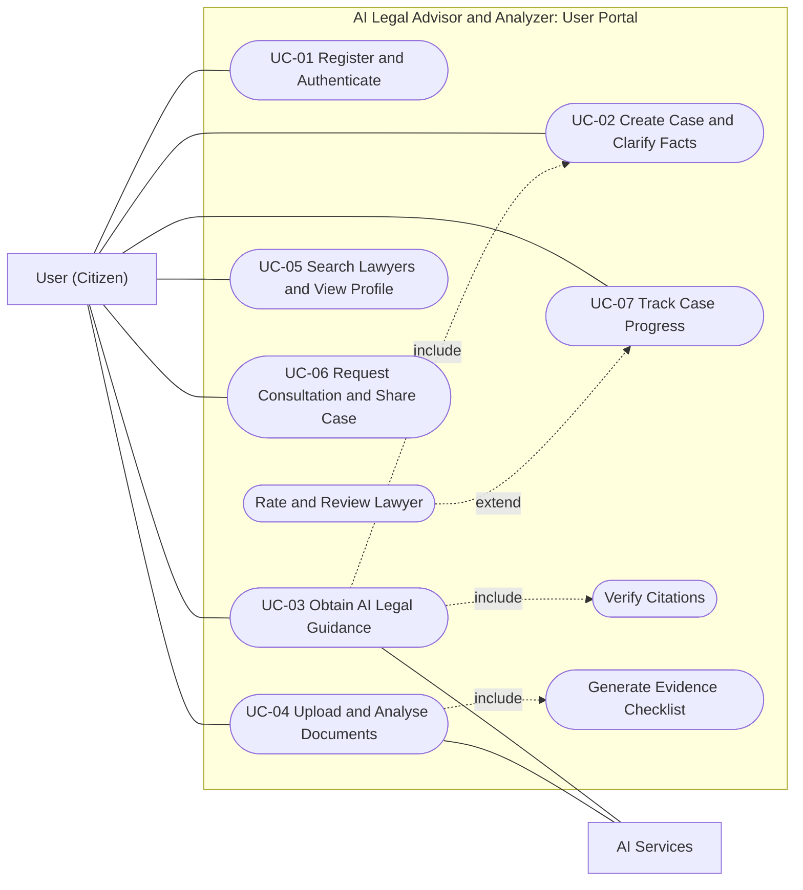

**Figure 3.2: Use case diagram, Lawyer portal**

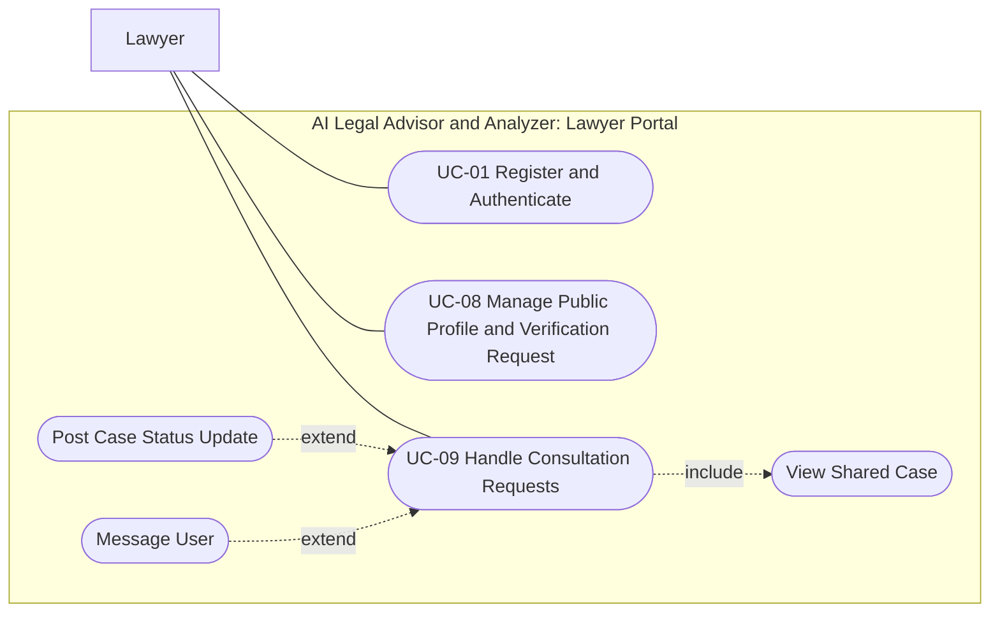

**Figure 3.3: Use case diagram, Admin portal**

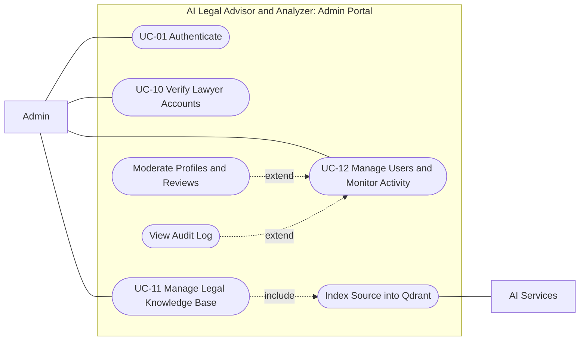

**Actor interactions.** The User drives the main journey: describe the problem, clarify facts, receive guidance, add evidence, find a lawyer, request a consultation and follow the case. The Lawyer enters the journey only when a User shares a case with consent, and can then respond, communicate and post updates that the User sees on the case timeline. The Admin is not part of individual cases. The Admin keeps the platform trustworthy by verifying lawyers, controlling which legal sources the AI may use, and moderating content.

### 3.3.1 Use Case 1: Register and Authenticate

| Field | Description |
|-------------|------------------------------------------------------------|
| **ID** | UC-01 |
| **Actors** | User, Lawyer, Admin (primary); Email Service (secondary) |
| **Description** | A person creates an account in the chosen role and logs in to the matching portal. |
| **Related requirements** | UFR-01 to UFR-04, LFR-01, LFR-02, AFR-01 |
| **Preconditions** | The person has a valid email address. For login, the account exists and is not suspended. |
| **Postconditions** | A new account is stored with a hashed password and an assigned role (lawyers in *pending verification*); on login, an access token is issued and the role's dashboard is shown. |

**Main flow**

1. The person opens the registration page and selects a role (User or Lawyer).
2. The person enters the required details; a lawyer also enters bar enrolment details and uploads the licence.
3. The system validates the input and checks that the email is not already registered.
4. The system stores the account with a hashed password and sends a verification email.
5. The person opens the verification link; the system activates the account.
6. The person logs in with email and password; the system verifies the credentials, issues an access token and opens the dashboard for the role.

**Alternative flows**

- *3a. Email already registered:* the system shows an error and offers login or password reset.
- *5a. Link expired:* the system offers to resend the verification email.
- *6a. Wrong credentials:* the system shows a generic error; after repeated failures it temporarily locks login for that account.
- *6b. Lawyer not yet verified:* the lawyer can log in and edit the profile, but the profile is not listed in the directory (LFR-04).
- *6c. Account suspended:* login is refused with a message to contact support.

### 3.3.2 Use Case 2: Create Case and Clarify Facts

| Field | Description |
|-------------|----------------------------------------------------|
| **ID** | UC-02 |
| **Actors** | User (primary); AI Services (secondary) |
| **Description** | The user describes a legal problem; the system classifies it and asks only the follow-up questions needed to complete the facts. |
| **Related requirements** | UFR-06, UFR-07, UFR-08, UFR-16 |
| **Preconditions** | The user is logged in. |
| **Postconditions** | A case exists with a legal area, topic, problem description and a set of answered follow-up questions; its status is *Clarified*. |

**Main flow**

1. The user selects "New case" and describes the problem in their own words.
2. The system creates a case and an AI chat session and stores the description.
3. The system classifies the legal area (property or family) and topic and shows them to the user.
4. The system compares the stated facts with the facts required for that topic and finds the missing ones.
5. The system asks one follow-up question; the user answers. Steps 4-5 repeat until no required fact is missing.
6. The system marks the case as *Clarified* and offers to generate guidance (UC-03).

**Alternative flows**

- *3a. Wrong classification:* the user changes the area or topic and the system recalculates the missing facts.
- *3b. Outside property and family law:* the system explains the scope limitation and suggests finding a lawyer (UC-05).
- *5a. User does not know the answer:* the user selects "Not sure"; the fact is recorded as unknown and the guidance will state the assumption.
- *5b. User uploads a document instead of answering:* UC-04 runs and extracted facts fill the missing items.

### 3.3.3 Use Case 3: Obtain AI Legal Guidance

| Field | Description |
|-------------|------------------------------------------------------------|
| **ID** | UC-03 |
| **Actors** | User (primary); AI Services (secondary) |
| **Description** | The system retrieves relevant Pakistani law and case references and generates plain-language guidance with verified citations. |
| **Related requirements** | UFR-09 to UFR-15 |
| **Preconditions** | The user is logged in and the case is *Clarified* (UC-02). The knowledge base contains verified, indexed sources. |
| **Postconditions** | A guidance record with citations is stored and linked to the case and chat session; the case status becomes *Guidance ready*. |

**Main flow**

1. The user requests guidance for the case.
2. The system builds a query from the case facts and creates its embedding with Sentence Transformers.
3. The system searches Qdrant for the top-k most similar law sections, filtered by legal area.
4. The system builds a grounded prompt (instructions, retrieved sections, case facts and question) and sends it to the open-source LLM.
5. The LLM returns a draft answer with source tags.
6. The system checks that every tag refers to a retrieved section and that every statement has a tag.
7. The system displays the plain-language answer, the sources list, the evidence checklist and the disclaimer.

**Alternative flows**

- *3a. No section above the relevance threshold:* the system states that no verified source covers the question and recommends a verified lawyer (UFR-13).
- *6a. Citation check fails:* the system regenerates once; if it fails again the answer is withheld and the user is told so.
- *4a. LLM service unavailable:* the system shows an error, keeps the case, and lets the user retry later (NFR-REL-01).
- *7a. Follow-up question:* the user asks a further question and the flow restarts from step 2 within the same session (UFR-15).

### 3.3.4 Use Case 4: Upload and Analyse Documents

| Field | Description |
|-------------|--------------------------------------------------|
| **ID** | UC-04 |
| **Actors** | User (primary); AI Services (secondary) |
| **Description** | The user uploads evidence; the system extracts text, identifies key clauses and updates the evidence checklist. |
| **Related requirements** | UFR-17 to UFR-20 |
| **Preconditions** | The user is logged in and has an open case. |
| **Postconditions** | The document, its extracted text and its clauses are stored; checklist items supported by the document are marked as available. |

**Main flow**

1. The user selects a case and uploads a PDF, JPG or PNG file.
2. The system validates type and size and saves the file in the document store.
3. The system checks whether the PDF has a text layer; if so it extracts text with PyMuPDF, otherwise it runs OCR.
4. The system identifies key clauses (e.g. parties, rent, term, notice period, dower) and links the document to the case.
5. The system updates the evidence checklist and shows the extracted clauses to the user.

**Alternative flows**

- *2a. Invalid type or size:* the upload is rejected with a reason.
- *3a. OCR text unreadable (low quality):* the system asks for a clearer image; the file is kept but marked *Low quality*.
- *4a. No recognised clauses:* the document is stored with its text and the user can label its type manually.

### 3.3.5 Use Case 5: Search Lawyers and View Public Profile

| Field | Description |
|-------------|-----------------------------------|
| **ID** | UC-05 |
| **Actors** | User (primary) |
| **Description** | The user finds verified lawyers and reads their public profiles. |
| **Related requirements** | UFR-22, UFR-23 |
| **Preconditions** | At least one lawyer has been verified (UC-10). Viewing a profile does not require a case. |
| **Postconditions** | None (read-only), unless the user continues to UC-06. |

**Main flow**

1. The user opens the lawyer directory, optionally from a guidance screen that pre-fills the legal area and city.
2. The user applies filters (specialisation, city, fee range, experience, language, rating).
3. The system returns verified lawyers that match, sorted by relevance and rating.
4. The user opens a profile; the system shows headline, about, practice areas, experience, education, bar details, languages, fees, rating and reviews.

**Alternative flows**

- *3a. No match:* the system suggests widening the filters (e.g. nearby cities or a wider fee range).

### 3.3.6 Use Case 6: Request Consultation and Share Case

| Field | Description |
|-------------|--------------------------------------------------------|
| **ID** | UC-06 |
| **Actors** | User (primary); Lawyer (secondary, notified) |
| **Description** | The user asks a verified lawyer for a consultation and shares the case after explicit consent. |
| **Related requirements** | UFR-21, UFR-24 to UFR-27, UFR-30 |
| **Preconditions** | The user is logged in, has a case and has opened a verified lawyer's profile (UC-05). |
| **Postconditions** | A consultation with status *Requested* exists; a consent record lists the items shared with the lawyer; the lawyer is notified. |

**Main flow**

1. The user selects "Request consultation" on the lawyer's profile.
2. The user selects the case, the preferred mode (online or in person), preferred time, and writes a message.
3. The system shows the consent screen listing what will be shared (case summary, guidance, documents, contact details) and lets the user untick optional items.
4. The user confirms consent.
5. The system creates the consultation and consent record, generates the case summary if needed, and notifies the lawyer.
6. The case timeline shows "Consultation requested".

**Alternative flows**

- *4a. User declines consent:* no consultation is created.
- *5a. Lawyer has paused new requests:* the system informs the user and suggests other lawyers.
- *Later. User revokes sharing:* the lawyer's access ends immediately and the timeline records the revocation (UFR-26).

### 3.3.7 Use Case 7: Track Case Progress

| Field | Description |
|-------------|------------------------------------|
| **ID** | UC-07 |
| **Actors** | User (primary) |
| **Description** | The user follows the case from creation to resolution. |
| **Related requirements** | UFR-29, UFR-30, UFR-28 |
| **Preconditions** | The user is logged in and owns the case. |
| **Postconditions** | The case may be marked *Resolved* or *Closed*; after a completed consultation the user may leave a review. |

**Main flow**

1. The user opens a case from the dashboard.
2. The system shows the case status, the timeline of events, the checklist progress and consultation details.
3. When the lawyer posts an update, the system adds it to the timeline and notifies the user.
4. When the matter is settled, the user marks the case as *Resolved*.

**Alternative flows**

- *4a. Consultation completed:* the system invites the user to rate and review the lawyer (extension, UFR-28).
- *4b. User abandons the case:* the user closes it; the data is kept until the user deletes it.

### 3.3.8 Use Case 8: Manage Public Profile and Verification Request

| Field | Description |
|-------------|--------------------------------------------|
| **ID** | UC-08 |
| **Actors** | Lawyer (primary); Admin (secondary) |
| **Description** | The lawyer builds a public profile and submits it for verification. |
| **Related requirements** | LFR-01, LFR-03 to LFR-05 |
| **Preconditions** | The lawyer is registered and logged in. |
| **Postconditions** | The profile is saved; a verification request is pending for the Admin. After approval, the profile is listed with a *Verified* badge. |

**Main flow**

1. The lawyer opens "My profile" and edits headline, about, practice areas, experience, education, languages, city, fees and photo.
2. The system validates and saves the profile, showing a preview of the public page.
3. The lawyer submits (or re-submits) the verification request with bar details and licence copy.
4. The system creates a verification request and notifies administrators.

**Alternative flows**

- *4a. Request rejected:* the lawyer sees the reason, corrects the details and re-submits.
- *1a. Verified lawyer edits bar details:* the profile returns to *pending verification* for those fields.

### 3.3.9 Use Case 9: Handle Consultation Requests and Update Case

| Field | Description |
|-------------|-------------------------------------------------------|
| **ID** | UC-09 |
| **Actors** | Lawyer (primary); User (secondary, notified) |
| **Description** | The lawyer reviews a consultation request, accepts or declines it, and posts progress on the case. |
| **Related requirements** | LFR-06 to LFR-11 |
| **Preconditions** | The lawyer is verified and logged in; a consultation request with active consent exists. |
| **Postconditions** | The consultation status changes (*Accepted*, *Declined*, *Scheduled*, *Completed*); updates appear on the user's case timeline. |

**Main flow**

1. The lawyer opens the requests list and selects a request.
2. The system shows the shared case summary, guidance, documents and checklist progress.
3. The lawyer accepts and confirms a time; the system updates the status to *Scheduled* and notifies the user.
4. During the matter, the lawyer posts status updates and messages; the system records each on the timeline.
5. After the consultation, the lawyer marks it *Completed*.

**Alternative flows**

- *3a. Decline:* the lawyer declines with an optional reason; the user is notified and the shared access ends.
- *3b. Propose another time:* the lawyer suggests a new time; the user accepts or cancels.
- *2a. Consent revoked:* the case is no longer visible and the request is closed.

### 3.3.10 Use Case 10: Verify Lawyer Accounts

| Field | Description |
|-------------|-------------------------------------------------|
| **ID** | UC-10 |
| **Actors** | Admin (primary); Lawyer (secondary, notified) |
| **Description** | The Admin checks a lawyer's submitted credentials and approves or rejects the account. |
| **Related requirements** | AFR-02, AFR-09, LFR-04 |
| **Preconditions** | The Admin is logged in; a pending verification request exists. |
| **Postconditions** | The lawyer's status is *Verified* or *Rejected*; the decision is recorded in the audit log and the lawyer is notified. |

**Main flow**

1. The Admin opens the verification queue.
2. The system shows the lawyer's details, bar enrolment information and licence document.
3. The Admin checks the details against the issuing bar council's records (outside the system) and approves.
4. The system sets the status to *Verified*, lists the profile in the directory, logs the action and notifies the lawyer.

**Alternative flows**

- *3a. Details do not match:* the Admin rejects with a reason; the lawyer is notified and may re-submit.
- *3b. More information needed:* the Admin requests clarification; the request stays pending.

### 3.3.11 Use Case 11: Manage Legal Knowledge Base

| Field | Description |
|-------------|-----------------------------------------------------|
| **ID** | UC-11 |
| **Actors** | Admin (primary); AI Services (secondary) |
| **Description** | The Admin adds, verifies, re-indexes or retires a legal source used by the AI assistant. |
| **Related requirements** | AFR-05 to AFR-07, NFR-SCL-02 |
| **Preconditions** | The Admin is logged in and holds the official text of the source. |
| **Postconditions** | The source and its section chunks are stored in MongoDB and their embeddings in Qdrant; only verified, active sources are retrievable. |

**Main flow**

1. The Admin selects "Add legal source" and uploads the official text with metadata (title, type, year, legal area, official URL).
2. The system extracts the text (PyMuPDF or OCR).
3. The system splits the text into section-wise chunks and attaches metadata to each.
4. The system creates an embedding for each chunk and upserts it into Qdrant with the chunk metadata as payload.
5. The Admin reviews a sample of chunks and marks the source as *Verified*; it becomes retrievable.

**Alternative flows**

- *3a. Section structure not detected:* the system falls back to fixed-length chunks with overlap and flags the source for manual review.
- *Later. Source amended:* the Admin uploads the new text; the system re-indexes and retires the old chunks.
- *Later. Source repealed:* the Admin retires it; its chunks are excluded from retrieval but kept for past citations.

### 3.3.12 Use Case 12: Manage Users and Monitor Activity

| Field | Description |
|-------------|--------------------------------|
| **ID** | UC-12 |
| **Actors** | Admin (primary) |
| **Description** | The Admin manages accounts, moderates content and monitors platform activity. |
| **Related requirements** | AFR-03, AFR-04, AFR-08, AFR-09 |
| **Preconditions** | The Admin is logged in. |
| **Postconditions** | Account or content changes are applied and recorded in the audit log. |

**Main flow**

1. The Admin opens the dashboard and views platform statistics.
2. The Admin searches for a user or lawyer and opens the account.
3. The Admin suspends, reactivates or removes the account, giving a reason.
4. The system applies the change, ends active sessions if suspended, and logs the action.

**Alternative flows**

- *2a. Reported content:* the Admin opens the reports queue and removes or keeps the reported profile item or review (extension).
- *1a. Audit review:* the Admin filters the audit log by date, administrator or action type (extension).

## 3.4 System Sequence Diagrams

The sequence diagrams show how the actors, the Next.js frontend, the FastAPI backend services, the AI services and the data stores interact in the main workflows. Solid arrows are requests and dashed arrows are responses.

### 3.4.1 Registration and Login

**Figure 3.4: Sequence diagram, registration and login**

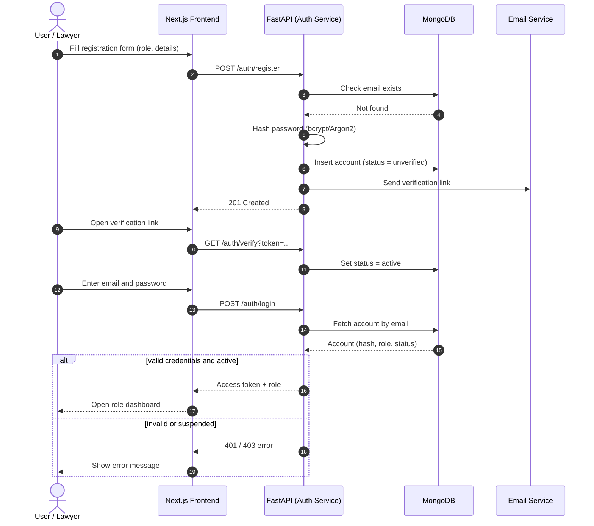

The Auth Service never stores plain passwords. It issues a signed token that carries the role, and every later request is checked against that role (NFR-SEC-02). A lawyer account is active after email verification but stays unlisted until UC-10 approves it.

### 3.4.2 Case Creation and Fact Clarification

**Figure 3.5: Sequence diagram, case creation and fact clarification**

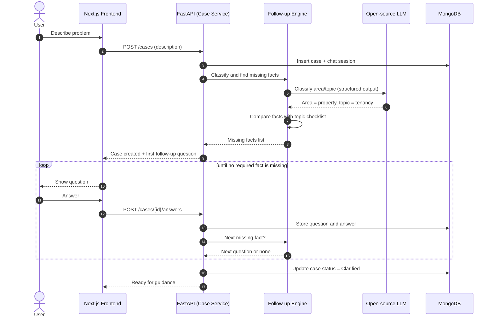

The LLM classifies the problem, but the list of required facts per topic is defined by the team and stored with the system. As a result, the follow-up questions are predictable and can be tested.

### 3.4.3 AI Legal Guidance (RAG)

**Figure 3.6: Sequence diagram, AI legal guidance with retrieval and citation verification**

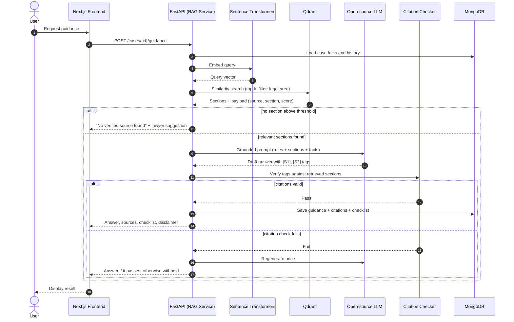

This is the central workflow of the project. The LLM never queries the databases. The RAG Service retrieves the sections first and passes only those sections to the LLM, then checks the returned citations before anything is displayed. This design responds directly to the hallucination findings in [8] and [9].

### 3.4.4 Document Upload, OCR and Evidence Checklist

**Figure 3.7: Sequence diagram, document upload and analysis**

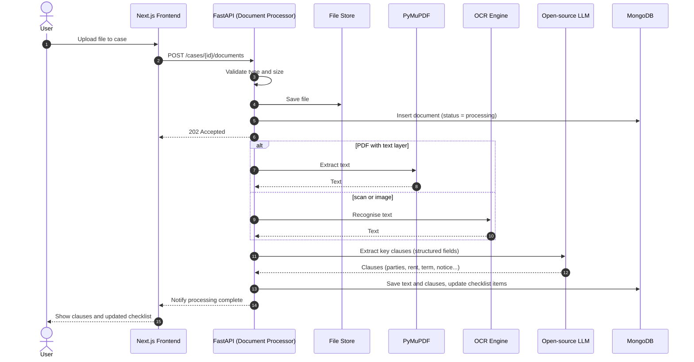

Extraction runs asynchronously, so the user is never blocked while a large scan is processed (NFR-REL-02). Clause extraction uses the user's own document as input. It does not depend on legal retrieval and produces structured fields that the user can see and correct.

### 3.4.5 Lawyer Search, Public Profile and Consultation Request

**Figure 3.8: Sequence diagram, lawyer search and consultation request**

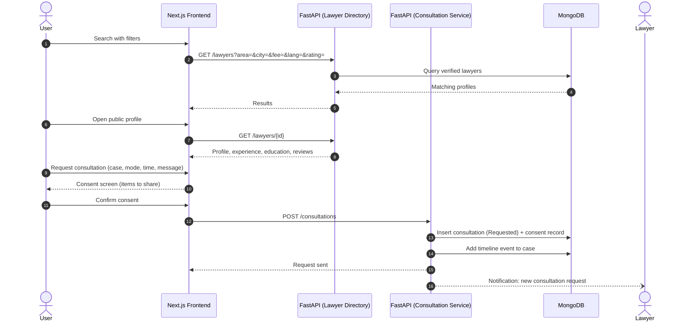

Only lawyers with *Verified* status are returned. Contact details are released only after the lawyer accepts (NFR-PRV-02). The consent record defines exactly which case items the lawyer may read.

### 3.4.6 Lawyer Handles Consultation and Updates Case

**Figure 3.9: Sequence diagram, lawyer response and case update**

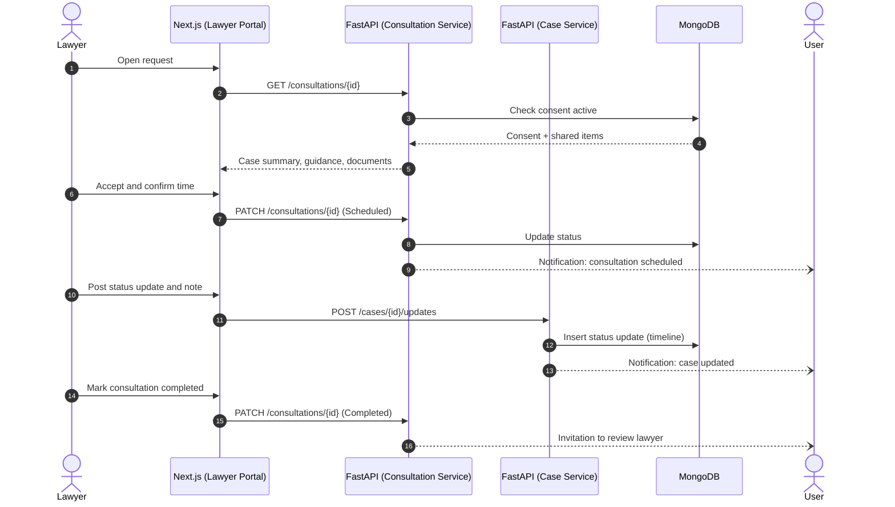

Every read by the lawyer is checked against the active consent record. If the user revokes consent, the next request is refused and the consultation is closed.

### 3.4.7 Admin Verifies a Lawyer

**Figure 3.10: Sequence diagram, lawyer verification**

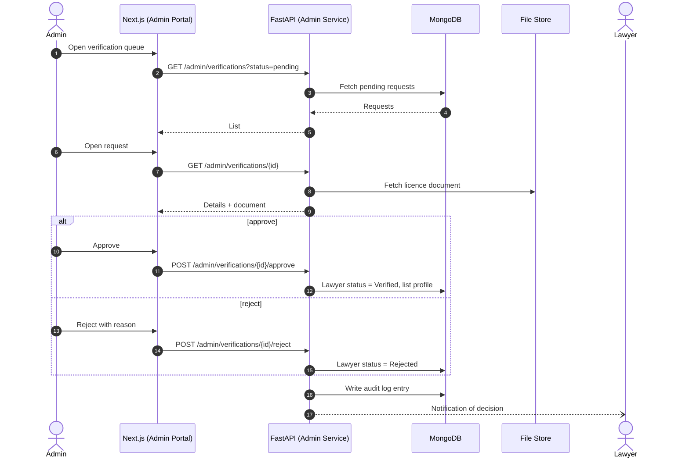

### 3.4.8 Admin Adds a Legal Source (Knowledge Base Ingestion)

**Figure 3.11: Sequence diagram, legal source ingestion**

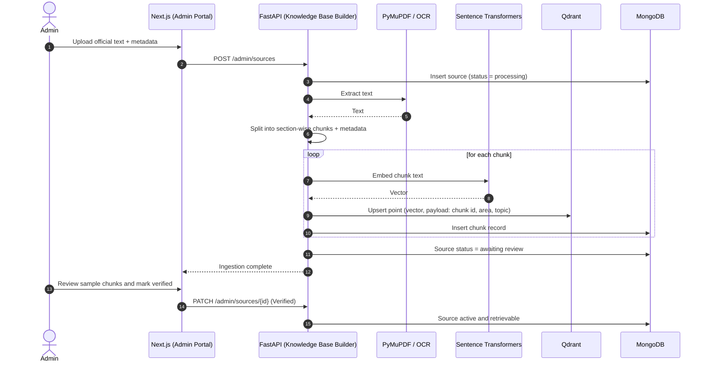

This is the offline phase of the RAG pipeline described in Chapter 1. Each Qdrant point carries the chunk identifier in its payload, so any retrieved vector can be traced back to its source and section for citation.

## 3.5 Domain Model

The domain model identifies the main entities of the system, their key attributes, and their relationships with cardinalities. `Account` is an abstract generalisation of the three actor types: `User` (citizen), `Lawyer` and `Admin`. `Case` is the central entity of the model.

**Figure 3.12: Domain model (UML class diagram)**

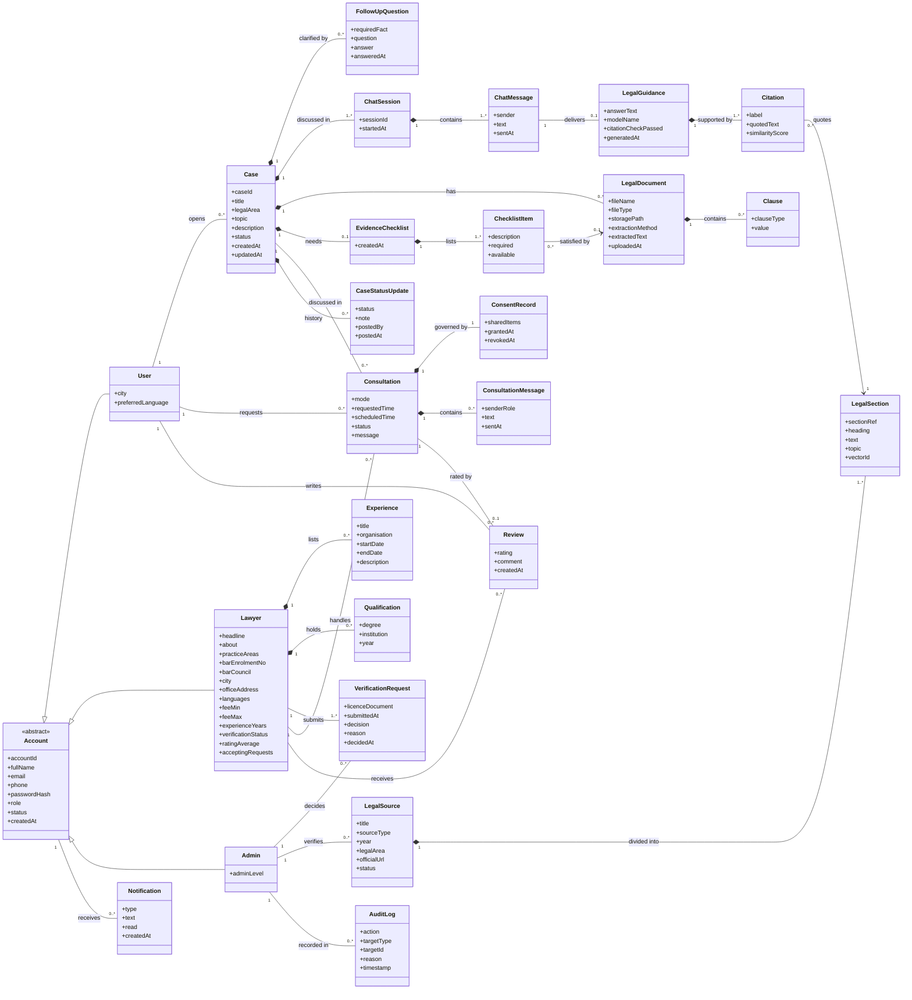

**Table 3.5: Main entities and their purpose**

| Entity | Purpose | Persistence |
|---------------------|------------------------------------------------------|------------|
| Account / User / Lawyer / Admin | Identity, role and role-specific data; `Lawyer` also holds the public profile. | MongoDB |
| Experience, Qualification | LinkedIn-style profile sections of a lawyer. | MongoDB (embedded in lawyer) |
| VerificationRequest | A lawyer's submitted credentials and the Admin's decision. | MongoDB + file store |
| Case | Central record of a citizen's legal problem and its status. | MongoDB |
| FollowUpQuestion | A missing fact asked about and the user's answer. | MongoDB |
| ChatSession, ChatMessage | The conversation between the user and the AI assistant. | MongoDB |
| LegalGuidance, Citation | An AI answer and the verified references supporting each statement. | MongoDB |
| LegalSource, LegalSection | Verified statutes, rules and judgments, split into sections. | MongoDB (text, metadata) + Qdrant (embedding) |
| LegalDocument, Clause | A user's uploaded evidence and the clauses extracted from it. | File store + MongoDB |
| EvidenceChecklist, ChecklistItem | Case-specific list of documents to prepare. | MongoDB |
| Consultation, ConsentRecord, ConsultationMessage | A user-lawyer engagement, what the user agreed to share, and the messages exchanged. | MongoDB |
| CaseStatusUpdate | Timeline entries posted by the user, lawyer or system. | MongoDB |
| Review | Rating and comment after a completed consultation. | MongoDB |
| Notification, AuditLog | User alerts and a record of administrative actions. | MongoDB |

**Key cardinalities explained.**

- A **User** may open many **Cases** (1 to 0..*), but each case belongs to exactly one user.
- A **Case** is discussed in one or more **ChatSessions**. Each assistant message may deliver at most one **LegalGuidance**, and every guidance must have at least one **Citation** (1..*). This enforces the rule that no unsupported answer is stored.
- Each **Citation** quotes exactly one **LegalSection**, and a section may be cited by many answers.
- A **Consultation** links one user, one lawyer and one case, and is governed by exactly one **ConsentRecord**. Users and lawyers are thereby connected many-to-many through consultations.
- A **Consultation** can receive at most one **Review**, which prevents duplicate reviews of the same engagement.

## 3.6 User Interface Design (Prototypes)

The interfaces follow five design principles derived from the requirements:

1. **Plain language first:** labels and guidance avoid unexplained legal terms (NFR-USA-03).
2. **Proof is visible:** every guidance statement shows a source tag that opens the cited law (UFR-11).
3. **Ask, don't assume:** missing facts are requested through short questions, and the facts collected so far are always shown (UFR-08).
4. **Consent before sharing:** the user sees exactly what a lawyer will receive (UFR-25).
5. **One consistent layout:** all three portals use the same sidebar navigation, colour palette (dark teal with gold accents) and components, and are responsive (NFR-USA-03).

High-fidelity prototypes of the core screens were produced as a clickable HTML prototype. Screens marked "To be prototyped" are specified here and will be designed in the next iteration.

**Figure 3.13: Portal navigation map**

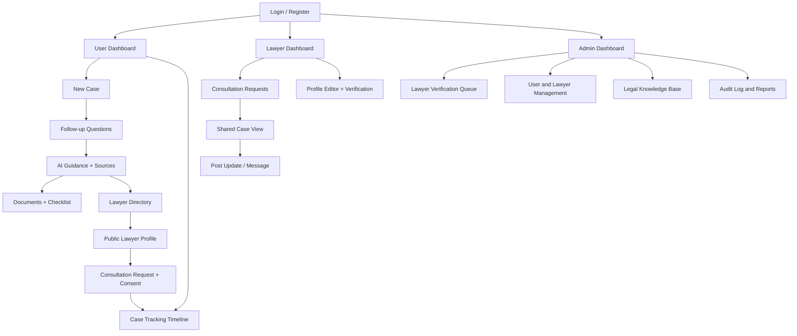

### 3.6.1 Authentication Screens

| Screen | Purpose and key elements | Requirements | Status |
|--------|------------------------------------------------------------|-------------|---------------|
| Sign in | Role selector (User, Lawyer, Admin), email, password, "Forgot password", link to register. A side panel explains the platform and the disclaimer. | UFR-02, LFR-02, AFR-01 | Prototyped (Figure 3.14) |
| Register | Role-specific form; lawyers also enter bar enrolment number, bar council and upload the licence. | UFR-01, LFR-01 | To be prototyped |
| Reset password | Email entry, then a new-password form from the emailed link. | UFR-03 | To be prototyped |

**Figure 3.14: Sign-in screen with role selection**

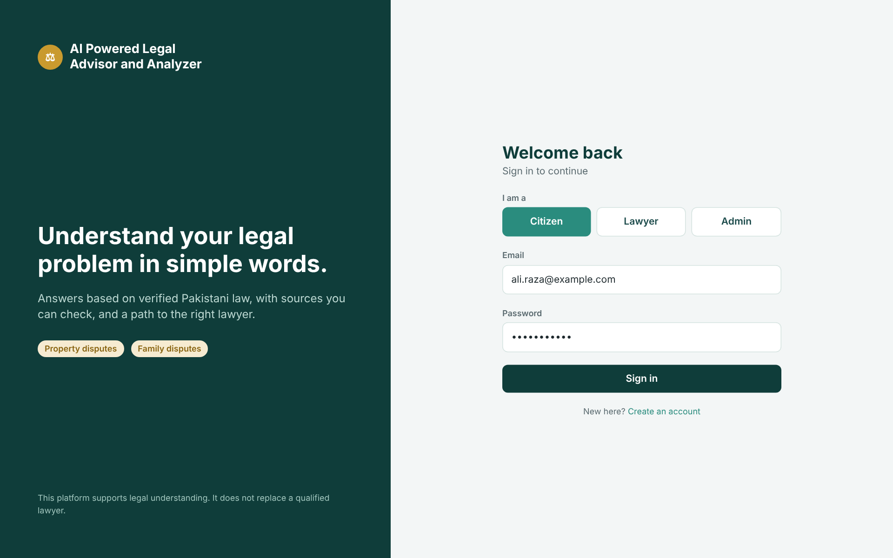

### 3.6.2 User Portal

| Screen | Purpose and key elements | Requirements | Status |
|-----------------|------------------------------------------------------------|-------------|---------------------------|
| User dashboard | Summary cards (open cases, cases needing an answer, shared cases), "New case" button, recent cases table with area and status. | UFR-16, UFR-29 | Prototyped (Figure 3.15) |
| New case | Title and free-text description, optional document attachment, detected legal area and topic with "Change area". | UFR-06, UFR-07 | Prototyped (Figure 3.16) |
| AI chat / follow-up questions | Chat view with the user's messages and the assistant's numbered follow-up questions; side panel "Facts so far" with completed and missing facts. | UFR-08, UFR-15 | Prototyped (Figure 3.17) |
| AI legal guidance | Plain-language answer with inline source tags, sources table (law, section, match), disclaimer, evidence checklist with progress bar, and "Find a lawyer" call to action. | UFR-10 to UFR-14, UFR-20 | Prototyped (Figure 3.18) |
| Documents | Drag-and-drop upload, file list with extraction method (PyMuPDF/OCR) and status, extracted key clauses. | UFR-17 to UFR-19 | Prototyped (Figure 3.19) |
| Lawyer directory | Filter panel (specialisation, city, fee, experience, language, rating) and result cards with verified badge, rating and fee range. | UFR-22 | Prototyped (Figure 3.20) |
| Public lawyer profile | Professional-network-style page: photo, headline, verified badge, about, practice areas, experience timeline, education, languages, fee range, reviews and "Request consultation". | UFR-23 | Header and consent dialog prototyped (Figure 3.21); full profile body to be prototyped |
| Consultation request and consent | Form for case, mode, preferred time and message, followed by a consent dialog listing the shared items. | UFR-24, UFR-25 | Consent dialog prototyped (Figure 3.21) |
| Case tracking | Case header with status, vertical timeline of events and lawyer updates, assigned lawyer card, checklist progress, "Stop sharing". | UFR-26, UFR-29 | Prototyped (Figure 3.22) |
| Consultation messages | Message thread with the lawyer inside an accepted consultation. | UFR-27 | To be prototyped |
| Profile and settings | Personal details, password change, notification preferences, account deletion. | UFR-04, UFR-05, UFR-30 | To be prototyped |

**Figure 3.15: User dashboard**

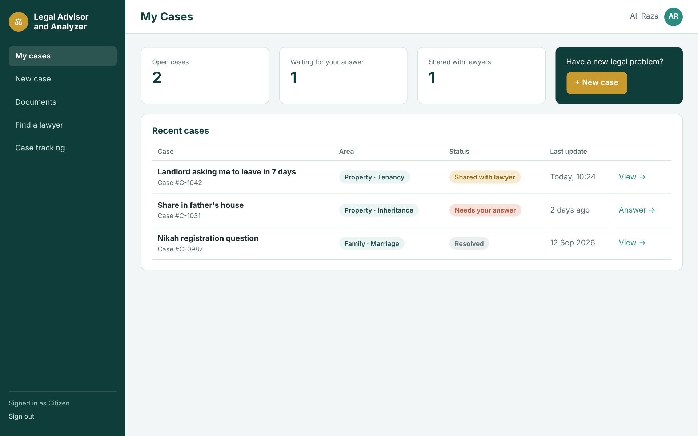

**Figure 3.16: New case screen**

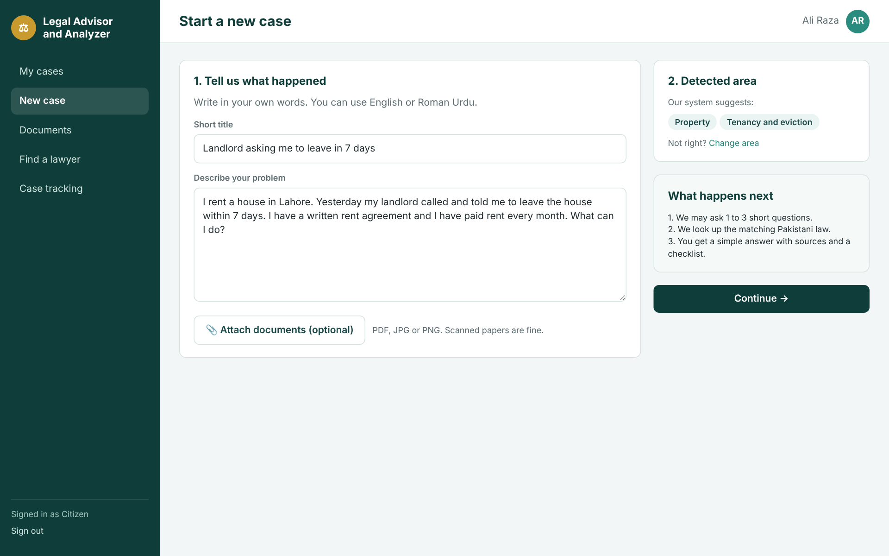

**Figure 3.17: AI chat with follow-up questions**

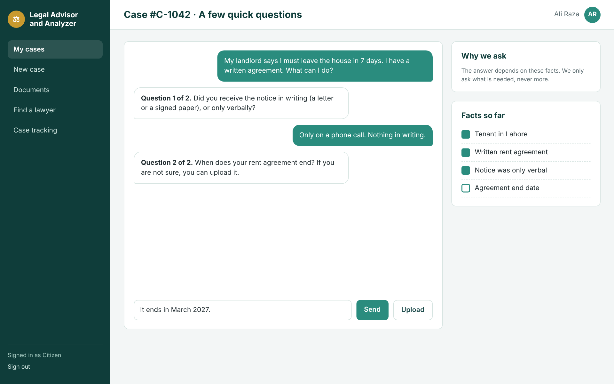

**Figure 3.18: AI legal guidance with sources and evidence checklist**

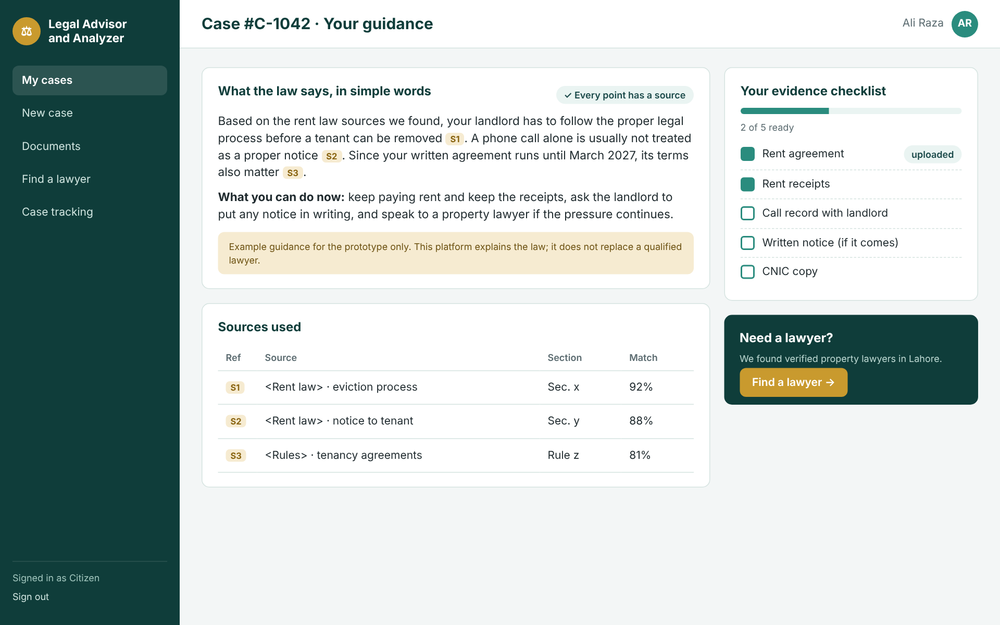

**Figure 3.19: Document upload and clause extraction**

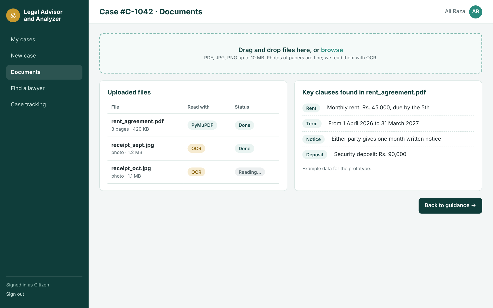

**Figure 3.20: Lawyer directory with filters**

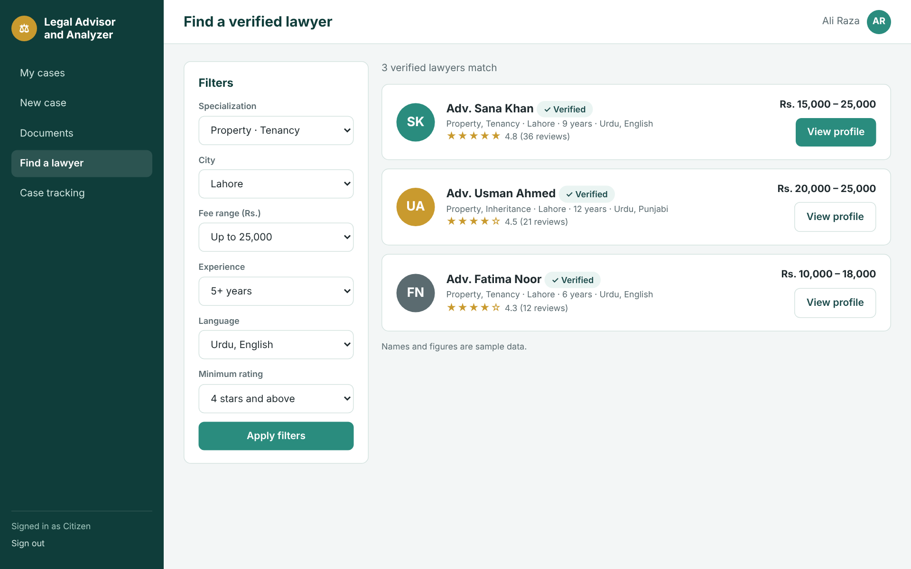

**Figure 3.21: Lawyer profile header and consent dialog before sharing a case**

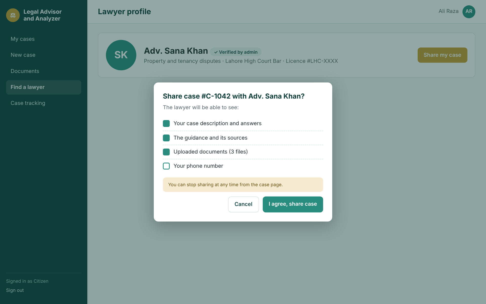

**Figure 3.22: Case tracking timeline**

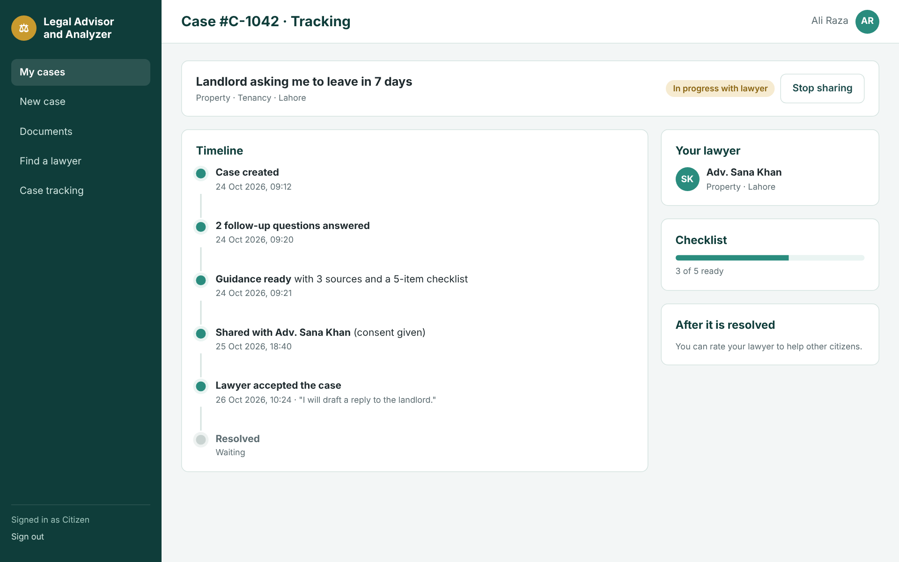

### 3.6.3 Lawyer Portal

| Screen | Purpose and key elements | Requirements | Status |
|--------------|------------------------------------------------------------|-----------------|---------------|
| Lawyer dashboard | Cards for new requests, active cases, completed consultations and rating; table of new consultation requests with Accept/Decline; form to post a status update. | LFR-06, LFR-07, LFR-10, LFR-12 | Prototyped (Figure 3.23) |
| Profile editor | Sections for headline, about, practice areas, experience entries, education, languages, fees and photo, with a live preview of the public page and the verification status. | LFR-03 to LFR-05 | To be prototyped |
| Shared case view | Read-only case summary, AI guidance with sources, documents and checklist, limited to consented items. | LFR-08 | To be prototyped |
| Consultation detail | Schedule, status controls (Scheduled, Completed), message thread with the user. | LFR-07, LFR-09, LFR-11 | To be prototyped |

**Figure 3.23: Lawyer portal dashboard**

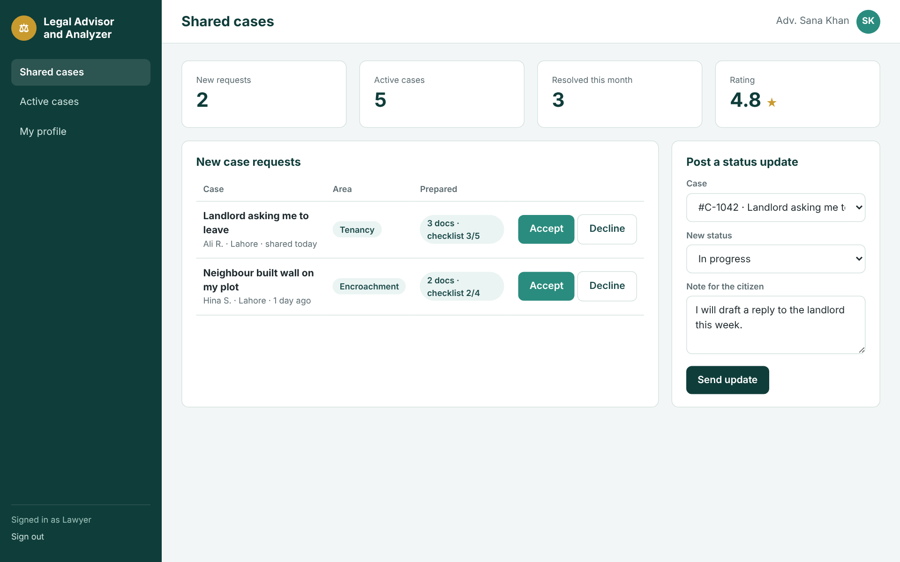

### 3.6.4 Admin Portal

| Screen | Purpose and key elements | Requirements | Status |
|----------------|------------------------------------------------------------|-----------|-----------------------|
| Admin dashboard | Platform statistics (users, verified lawyers, open cases, indexed sections); lawyer verification queue with Approve/Reject; knowledge-base summary per legal area. | AFR-02, AFR-05, AFR-08 | Prototyped (Figure 3.24) |
| User and lawyer management | Searchable table of accounts with role, status and actions (suspend, reactivate, remove). | AFR-03 | To be prototyped |
| Legal knowledge base | List of sources with type, year, area, status (processing, awaiting review, verified, retired); "Add source"; chunk review panel. | AFR-05 to AFR-07 | Summary prototyped (Figure 3.24); full screen to be prototyped |
| Reports and moderation | Queue of reported profile items and reviews with keep/remove actions. | AFR-04 | To be prototyped |
| Audit log | Filterable list of administrative actions by date, admin and action type. | AFR-09 | To be prototyped |

**Figure 3.24: Admin portal dashboard**

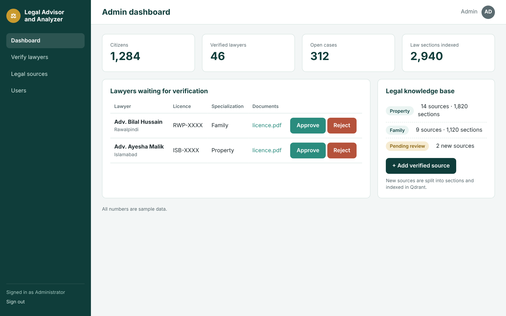

The prototypes use sample data (names, fees, statistics and example legal text) for illustration only. They reflect the planned behaviour of the system and do not represent implemented functionality.

# References (Chapters 2 and 3)

[1] H. Zhong, C. Xiao, C. Tu, T. Zhang, Z. Liu and M. Sun, "How Does NLP Benefit Legal System: A Summary of Legal Artificial Intelligence," in *Proc. 58th Annual Meeting of the Association for Computational Linguistics (ACL)*, 2020, pp. 5218-5230. https://aclanthology.org/2020.acl-main.466

[2] I. Chalkidis, M. Fergadiotis, P. Malakasiotis, N. Aletras and I. Androutsopoulos, "LEGAL-BERT: The Muppets straight out of Law School," in *Findings of the Association for Computational Linguistics: EMNLP 2020*, pp. 2898-2904. https://aclanthology.org/2020.findings-emnlp.261

[3] L. Zheng, N. Guha, B. R. Anderson, P. Henderson and D. E. Ho, "When Does Pretraining Help? Assessing Self-Supervised Learning for Law and the CaseHOLD Dataset," in *Proc. 18th International Conference on Artificial Intelligence and Law (ICAIL)*, 2021. https://arxiv.org/abs/2104.08671

[4] I. Chalkidis, A. Jana, D. Hartung, M. Bommarito, I. Androutsopoulos, D. M. Katz and N. Aletras, "LexGLUE: A Benchmark Dataset for Legal Language Understanding in English," in *Proc. 60th Annual Meeting of the ACL*, 2022, pp. 4310-4330. https://aclanthology.org/2022.acl-long.297

[5] V. Malik, R. Sanjay, S. K. Nigam, K. Ghosh, S. K. Guha, A. Bhattacharya and A. Modi, "ILDC for CJPE: Indian Legal Documents Corpus for Court Judgment Prediction and Explanation," in *Proc. ACL-IJCNLP 2021*, pp. 4046-4062. https://aclanthology.org/2021.acl-long.313

[6] N. Guha et al., "LegalBench: A Collaboratively Built Benchmark for Measuring Legal Reasoning in Large Language Models," in *Advances in Neural Information Processing Systems 36 (NeurIPS 2023), Datasets and Benchmarks Track*. https://proceedings.neurips.cc/paper_files/paper/2023/hash/89e44582fd28ddfea1ea4dcb0ebbf4b0-Abstract.html

[7] D. M. Katz, M. J. Bommarito, S. Gao and P. Arredondo, "GPT-4 passes the bar exam," *Philosophical Transactions of the Royal Society A*, vol. 382, no. 2270, 20230254, 2024. https://doi.org/10.1098/rsta.2023.0254

[8] M. Dahl, V. Magesh, M. Suzgun and D. E. Ho, "Large Legal Fictions: Profiling Legal Hallucinations in Large Language Models," *Journal of Legal Analysis*, vol. 16, no. 1, pp. 64-93, 2024. https://doi.org/10.1093/jla/laae003

[9] V. Magesh, F. Surani, M. Dahl, M. Suzgun, C. D. Manning and D. E. Ho, "Hallucination-Free? Assessing the Reliability of Leading AI Legal Research Tools," *Journal of Empirical Legal Studies*, vol. 22, no. 2, pp. 216-242, 2025. https://doi.org/10.1111/jels.12413

[10] Z. Ji et al., "Survey of Hallucination in Natural Language Generation," *ACM Computing Surveys*, vol. 55, no. 12, Art. 248, 2023. https://doi.org/10.1145/3571730

[11] P. Lewis et al., "Retrieval-Augmented Generation for Knowledge-Intensive NLP Tasks," in *Advances in Neural Information Processing Systems 33 (NeurIPS 2020)*. https://arxiv.org/abs/2005.11401

[12] V. Karpukhin, B. Oguz, S. Min, P. Lewis, L. Wu, S. Edunov, D. Chen and W. Yih, "Dense Passage Retrieval for Open-Domain Question Answering," in *Proc. EMNLP 2020*, pp. 6769-6781. https://aclanthology.org/2020.emnlp-main.550

[13] N. Reimers and I. Gurevych, "Sentence-BERT: Sentence Embeddings using Siamese BERT-Networks," in *Proc. EMNLP-IJCNLP 2019*, pp. 3982-3992. https://aclanthology.org/D19-1410

[14] J. Johnson, M. Douze and H. Jégou, "Billion-scale similarity search with GPUs," *IEEE Transactions on Big Data*, vol. 7, no. 3, pp. 535-547; preprint arXiv:1702.08734. https://arxiv.org/abs/1702.08734

[15] Y. Gao et al., "Retrieval-Augmented Generation for Large Language Models: A Survey," arXiv:2312.10997, 2023. https://arxiv.org/abs/2312.10997

[16] A. Louis, G. van Dijck and G. Spanakis, "Interpretable Long-Form Legal Question Answering with Retrieval-Augmented Large Language Models," in *Proc. AAAI Conference on Artificial Intelligence*, vol. 38, no. 20, 2024, pp. 22266-22275. https://ojs.aaai.org/index.php/AAAI/article/view/30232

[17] J. Cui, Z. Li et al., "ChatLaw: Open-Source Legal Large Language Model with Integrated External Knowledge Bases," arXiv:2306.16092 (v1), 2023. https://arxiv.org/abs/2306.16092

[18] A. Maqsood, A. Ul-Hasan and F. Shafait, "Transformer-Based Architecture for Judgment Prediction and Explanation in Legal Proceedings," in *Document Analysis Systems (DAS 2024)*, Lecture Notes in Computer Science, vol. 14994, Springer, 2024, pp. 20-36. https://doi.org/10.1007/978-3-031-70442-0_2

[19] F. Faisal and U. Yousaf, "LEGAL-UQA: A Low-Resource Urdu-English Dataset for Legal Question Answering," arXiv:2410.13013, 2024. https://arxiv.org/abs/2410.13013

[20] Qdrant, "Qdrant Documentation: Indexing and Filtering." https://qdrant.tech/documentation/

[21] Stanford CodeX TechIndex, "MyCounsel." https://techindex.law.stanford.edu/companies/mycounsel

[22] Stanford CodeX TechIndex, "QanoonAI." https://techindex.law.stanford.edu/companies/qanoonai

[23] Stanford CodeX TechIndex, "PakLegalAI." https://techindex.law.stanford.edu/companies/paklegalai

[24] Stanford CodeX TechIndex, "Pakistan Law Bot." https://techindex.law.stanford.edu/companies/pakistan-law-bot

[25] World Justice Project, "WJP Rule of Law Index 2025." https://worldjusticeproject.org/rule-of-law-index/

[26] Dawn, "July-Dec 2023 statistics show 2.26 million cases pending in courts: report." https://www.dawn.com/news/1814586

[27] OpenGov Asia, "Indian Supreme Court unveils first AI research portal," April 2021. https://archive.opengovasia.com/2021/04/16/indian-supreme-court-unveils-first-ai-research-portal/

[28] International Bar Association, "AI in Pakistani courts of law." https://www.ibanet.org/AI-in-Pakistani-courts-of-law

[29] J. Brooke, "SUS: A 'quick and dirty' usability scale," in P. W. Jordan, B. Thomas, B. A. Weerdmeester and A. L. McClelland (eds.), *Usability Evaluation in Industry*. London: Taylor and Francis, 1996.

[30] A. Bangor, P. T. Kortum and J. T. Miller, "An Empirical Evaluation of the System Usability Scale," *International Journal of Human-Computer Interaction*, vol. 24, no. 6, pp. 574-594, 2008. https://doi.org/10.1080/10447310802205776

[31] Government of Pakistan, Ministry of Law and Justice, "Pakistan Code." https://pakistancode.gov.pk
